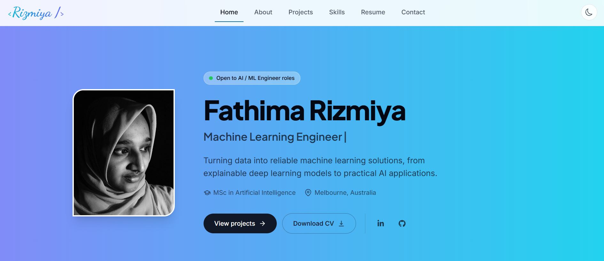

# Rizmiya's Portfolio Website

Personal portfolio of Fathima Rizmiya, an MSc in Artificial Intelligence graduate based in Melbourne, focused on AI and machine learning engineering.

**Live site:** [rizmiya.com](https://rizmiya.com)



## Overview

The site presents my AI and machine learning projects, technical skills, education, experience and certifications, with a downloadable CV and a contact form. Projects include an interpretable graph neural network for molecular toxicity prediction (my MSc thesis), an LLM research agent built with LangChain, and full-stack web applications built with Next.js.

## Technologies Used

- Next.js 13 (App Router) and React 18
- TypeScript
- Tailwind CSS, with a light and dark theme
- Framer Motion for animations and transitions
- Nodemailer with Gmail SMTP for the contact form
- Vercel for hosting

## Features

- Single-page layout: Home, About, Projects, Skills, Resume and Contact
- Responsive design for mobile, tablet and desktop
- Light and dark mode that remembers your choice
- Project cards with screenshots, tech tags, and code and live demo links
- Downloadable CV
- Working contact form that sends messages by email
- Open Graph preview image for sharing links

<!-- ## Running Locally

```bash
npm ci
npm run dev
```

Then open http://localhost:3000.

The contact form needs a `.env.local` file in the project root:

```
EMAIL=your-gmail-address@gmail.com
EMAIL_PASS=your-gmail-app-password
```

`EMAIL_PASS` is a Gmail App Password, not your normal password. Add the same two variables in Vercel under Settings → Environment Variables. -->

## Live Demo

[rizmiya.com](https://rizmiya.com)
